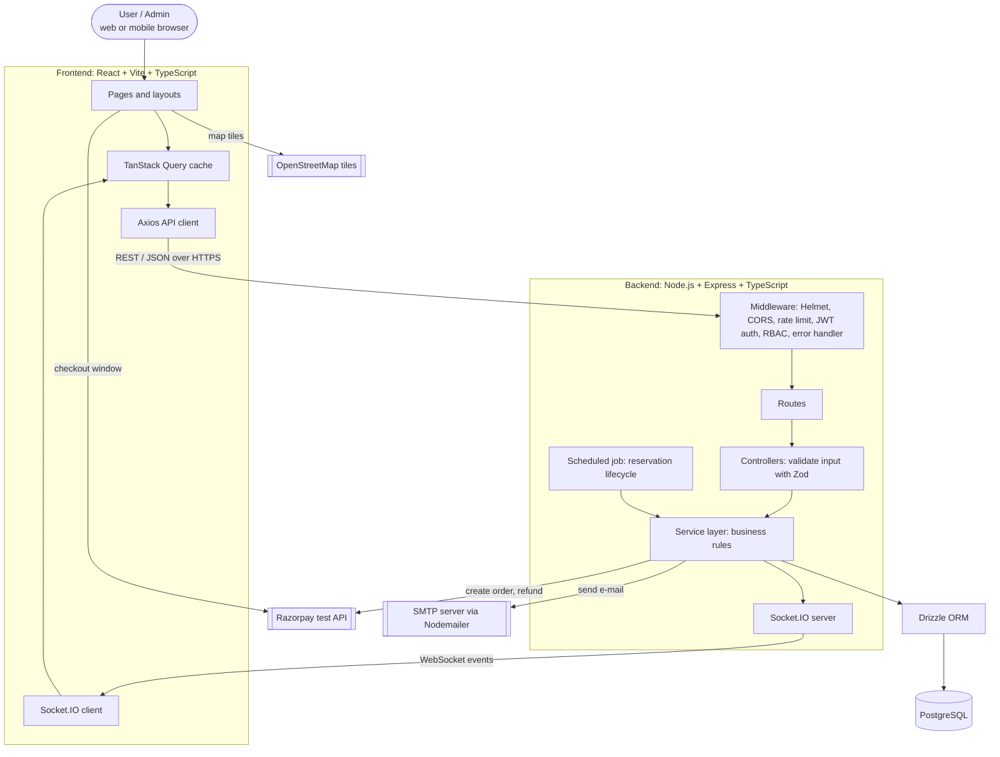
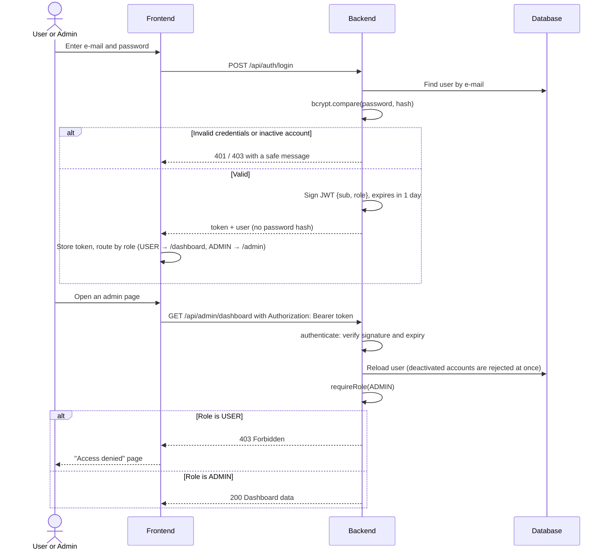
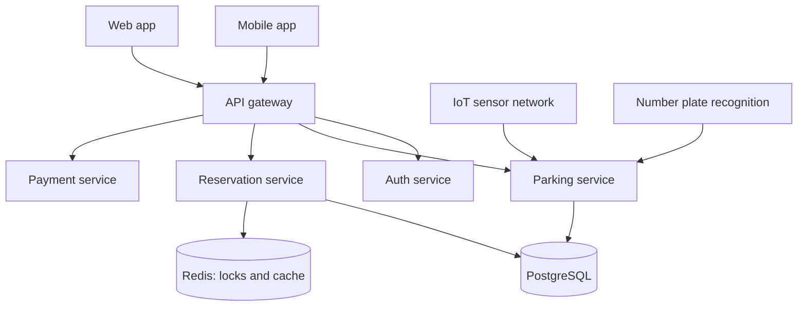

# System Architecture

## High-level architecture

> Rendered image for submission: [`diagrams/ARCHITECTURE-1.png`](diagrams/ARCHITECTURE-1.png) (also available as `.svg`).

## Layers

| Layer | Folder | Responsibility |
|---|---|---|
| Presentation | `frontend/src/pages`, `layouts`, `components`, `features` | Render UI, collect input, show loading / empty / error states. No business rules. |
| Client data | `frontend/src/api`, `hooks`, `contexts`, `services` | HTTP client, auth session, realtime invalidation, Razorpay checkout. |
| Routing | `backend/src/routes` | Map URL + method to a controller and attach auth middleware. |
| Controllers | `backend/src/controllers` | Parse and validate the request (Zod), call one service, shape the response. |
| Services | `backend/src/services` | All business logic: availability, pricing, booking, payment, notifications, statistics. |
| Persistence | `backend/src/db` | Schema, migrations, seed data, connection pool. |
| Background | `backend/src/jobs` | Minute-by-minute reservation lifecycle. |
| Realtime | `backend/src/sockets` | Socket.IO rooms and event emitters. |

The backend strictly follows **Routes → Controllers → Services → Database**. Route files contain no logic.

## Authentication and authorisation flow

> Rendered image for submission: [`diagrams/ARCHITECTURE-2.png`](diagrams/ARCHITECTURE-2.png) (also available as `.svg`).

- Passwords are hashed with bcrypt (cost 10) and never returned by any endpoint.
- The frontend also guards routes (`routes/guards.tsx`), but this is only for user experience: every
  protected API re-checks the token and role on the server.
- An expired token returns `401 TOKEN_EXPIRED`; the frontend clears the session and shows the login page.

## Data flows

### 1. User → Frontend → Backend → Database (reading and writing data)

1. The user acts in the browser (e.g. types a search term).
2. A React Query hook calls the typed API client (`frontend/src/api/index.ts`), which sends an HTTP request with the JWT.
3. Express middleware authenticates the request; the controller validates input with Zod.
4. The service applies business rules and reads/writes PostgreSQL through Drizzle (parameterised SQL only).
5. The JSON response is cached by React Query and rendered. Validation errors return `400` with field-level details.

### 2. Frontend → Backend → Payment Gateway

1. The frontend asks the backend to create an order for a pending reservation. The **amount comes from the database**, never from the browser.
2. The backend creates a Razorpay order using the key secret and stores the order ID.
3. The frontend opens Razorpay Checkout with the **public key ID** and order ID. The key secret never leaves the server.
4. Razorpay returns `payment_id` and `signature` to the frontend, which forwards them to the backend.
5. The backend recomputes `HMAC_SHA256(order_id + "|" + payment_id, key_secret)` and compares it with the signature in constant time. Only then is the payment marked `SUCCESS` and the reservation `CONFIRMED`.

When no Razorpay keys are configured, steps 2-5 are replaced by the built-in **simulated gateway**, which is
clearly labelled in the UI and stored as `provider = MOCK`.

### 3. Backend → Notification Service → User

1. A service calls `notify()` after a booking event (confirmation, payment, reminder, cancellation).
2. The notification is **persisted** in `notifications`.
3. It is pushed over Socket.IO to the room `user:<id>`; the navbar bell updates without a refresh.
4. The same text is e-mailed with Nodemailer. Without SMTP settings the e-mail is logged to the server console instead; a mail failure never breaks a booking.

## Real-time updates

| Event | Sent to | Trigger | Client reaction |
|---|---|---|---|
| `slots:changed {areaId}` | everyone | admin changes a slot; reservation confirmed, cancelled, completed or expired | refetch areas, slots and admin statistics |
| `notification:new` | `user:<id>` | any notification for that user | update bell badge, show toast |
| `admin:activity` | `admins` | reservation, payment, user or parking change | refetch admin screens |

Events carry no data that needs trusting: they only tell clients to refetch through the authenticated REST API.

## Slot status model

A slot has a **live status** (what is physically true now) and a **bookability for a time window** (computed from reservations).

| Live status | Set by | Meaning |
|---|---|---|
| AVAILABLE | system | Free right now |
| RESERVED | system | A paid booking is running or starts within 30 minutes |
| OCCUPIED | admin (simulation) / future sensor | A vehicle is in the bay |
| MAINTENANCE | admin | Out of service; cannot be booked |

A booking for tomorrow does not make the bay look taken today; it only blocks that time window.

## Occupancy simulation and future IoT integration

There are no physical sensors in this project. The admin *Occupancy* page is labelled **Simulation Mode**:
the administrator marks bays occupied or available, standing in for sensor readings. A real deployment would
have a sensor gateway call the same endpoint (`PATCH /api/slots/:id/status`) with a device credential; no other
part of the system would change.

## Future architecture

The modular service layer allows a later split into services behind an API gateway:

> Rendered image for submission: [`diagrams/ARCHITECTURE-3.png`](diagrams/ARCHITECTURE-3.png) (also available as `.svg`).
