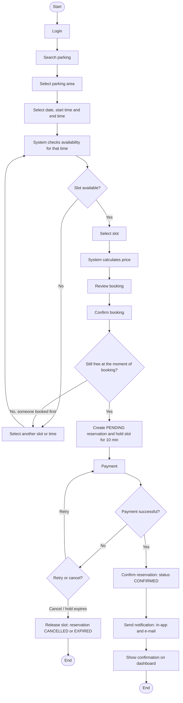
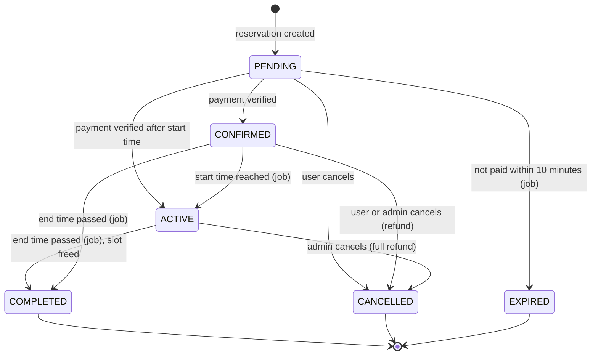

# Activity Diagram: Booking a Parking Slot

> Rendered image for submission: [`diagrams/activity-diagram-1.png`](diagrams/activity-diagram-1.png) (also available as `.svg`).

## Reservation state machine

The activity above moves a reservation through these states. Transitions on the right-hand side
are made automatically by the scheduled job (`backend/src/jobs/reservationLifecycle.ts`, every minute).

> Rendered image for submission: [`diagrams/activity-diagram-2.png`](diagrams/activity-diagram-2.png) (also available as `.svg`).
