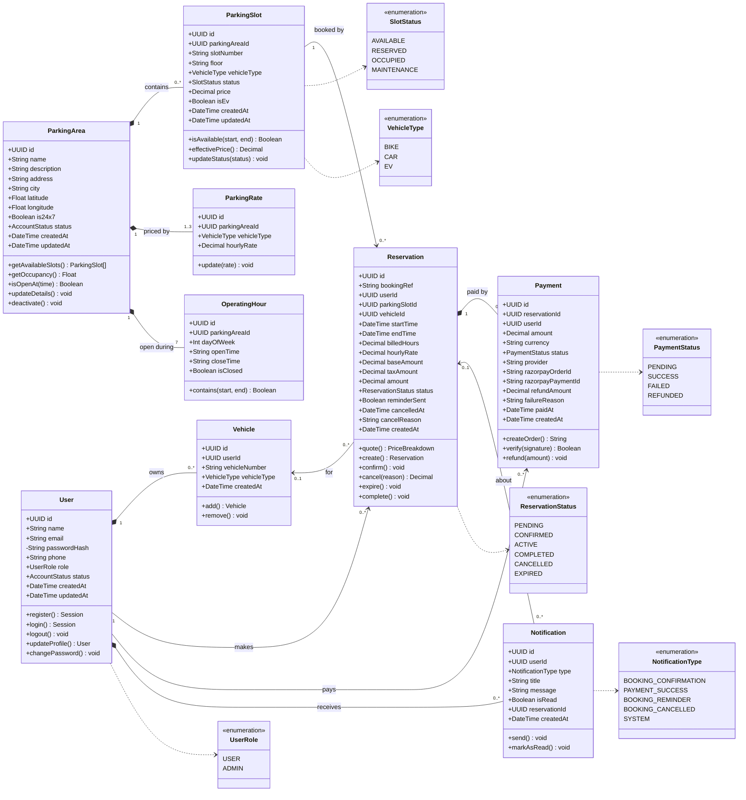

# Class Diagram

The classes below are the domain model of the Smart Parking Management System. Attributes map
one-to-one to the database columns defined in `backend/src/db/schema.ts`; operations map to the
functions of the service layer (`backend/src/services/*.service.ts`), listed in the table at the end.

> Rendered image for submission: [`diagrams/class-diagram.png`](diagrams/class-diagram.png) (also available as `.svg`).

## Relationships and multiplicity

| Relationship | Multiplicity | Kind | Meaning |
|---|---|---|---|
| User – Vehicle | 1 to 0..* | Composition | A vehicle belongs to exactly one user and is deleted with the user. |
| User – Reservation | 1 to 0..* | Association | A user makes many reservations; a reservation has exactly one user. |
| User – Notification | 1 to 0..* | Composition | Notifications exist only for their user. |
| User – Payment | 1 to 0..* | Association | Every payment records who paid. |
| ParkingArea – ParkingSlot | 1 to 0..* | Composition | A slot cannot exist without its parking area. |
| ParkingArea – ParkingRate | 1 to 1..3 | Composition | One hourly rate per vehicle type offered. |
| ParkingArea – OperatingHour | 1 to 7 | Composition | One row per day of the week. |
| ParkingSlot – Reservation | 1 to 0..* | Association | A slot is booked many times, never for overlapping periods. |
| Reservation – Payment | 1 to 0..1 | Composition | A reservation has at most one payment record (retries update it). |
| Reservation – Vehicle | 0..* to 0..1 | Association | The vehicle is optional. |
| Notification – Reservation | 0..* to 0..1 | Association | Booking notifications link to their reservation. |

## Where each operation is implemented

| Class | Operation | Implementation |
|---|---|---|
| User | register, login, updateProfile, changePassword | `auth.service.ts` |
| Vehicle | add, remove | `vehicle.service.ts` |
| ParkingArea | getAvailableSlots, getOccupancy, updateDetails, deactivate | `parking.service.ts` |
| ParkingArea | isOpenAt | `availability.ts` (`isOpenAt`, `assertWithinOperatingHours`) |
| ParkingSlot | isAvailable | `availability.ts` (`conflictingSlotIds`) |
| ParkingSlot | updateStatus | `slot.service.ts` (`changeSlotStatus`), `availability.ts` (`syncSlotStatuses`) |
| Reservation | quote, create, cancel | `reservation.service.ts` |
| Reservation | expire, complete | `jobs/reservationLifecycle.ts` |
| Payment | createOrder, verify | `payment.service.ts`, `payment.gateway.ts` |
| Payment | refund | `reservation.service.ts` (`cancelReservation`), `payment.gateway.ts` (`refundOnGateway`) |
| Notification | send, markAsRead | `notification.service.ts` |

> The backend is written in a functional service style rather than with ES classes, which is
> idiomatic for Express + TypeScript. The class diagram is the conceptual (analysis-level) model:
> each class is a database entity plus the service functions that operate on it.
