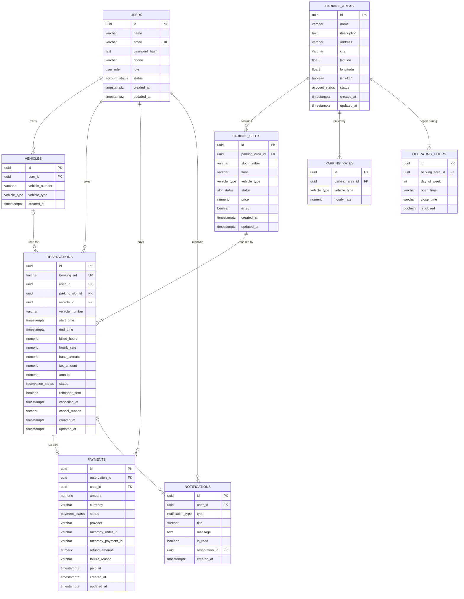

# Database Design

PostgreSQL, accessed through Drizzle ORM. The schema is defined in TypeScript in
`backend/src/db/schema.ts`; the generated SQL migration is `backend/drizzle/0000_init.sql`.

## ER diagram



> Rendered image for submission: [`diagrams/database-design.png`](diagrams/database-design.png) (also available as `.svg`).

## Tables

| Table | Purpose | Key constraints |
|---|---|---|
| `users` | Customers and administrators | `email` unique; `role` enum; `status` enum |
| `vehicles` | Vehicles saved by a user | unique `(user_id, vehicle_number)`; cascade delete with user |
| `parking_areas` | A parking facility with location | indexes on `city`, `status`; soft-deleted via `status = INACTIVE` |
| `parking_rates` | Hourly rate per vehicle type per area | unique `(parking_area_id, vehicle_type)` |
| `operating_hours` | Opening hours per weekday per area | unique `(parking_area_id, day_of_week)`; 0 = Sunday |
| `parking_slots` | An individual bay | unique `(parking_area_id, slot_number)`; index on `status` |
| `reservations` | A booking of one slot for a time window | `booking_ref` unique; index `(parking_slot_id, start_time, end_time)` for overlap checks |
| `payments` | The payment for a reservation | `reservation_id` unique (one payment per reservation) |
| `notifications` | In-app notifications | index `(user_id, is_read)` for the unread badge |

## Enumerations

| Enum | Values |
|---|---|
| `user_role` | USER, ADMIN |
| `account_status` | ACTIVE, INACTIVE |
| `slot_status` | AVAILABLE, RESERVED, OCCUPIED, MAINTENANCE |
| `reservation_status` | PENDING, CONFIRMED, ACTIVE, COMPLETED, CANCELLED, EXPIRED |
| `payment_status` | PENDING, SUCCESS, FAILED, REFUNDED |
| `vehicle_type` | BIKE, CAR, EV |
| `notification_type` | BOOKING_CONFIRMATION, PAYMENT_SUCCESS, BOOKING_REMINDER, BOOKING_CANCELLED, SYSTEM |

## Design decisions

- **UUID primary keys** (`gen_random_uuid()`), so identifiers are not guessable and can be created on any node.
- **Money is `numeric(10,2)`**, never floating point. The price breakdown (`hourly_rate`, `billed_hours`, `base_amount`, `tax_amount`, `amount`) is stored on the reservation, so a later rate change never alters a past booking.
- **All timestamps are `timestamptz`** (stored in UTC). Operating hours are plain `HH:MM` strings interpreted in `APP_TIMEZONE`.
- **Normalisation.** The schema is in third normal form: rates and operating hours are separate tables rather than repeated columns on `parking_areas`; a slot's price is optional and falls back to the area rate. Two deliberate denormalisations exist for audit reasons: `reservations.vehicle_number` and the price snapshot columns.
- **Referential actions.** Child configuration rows cascade with their parent (`vehicles`, `parking_slots`, `parking_rates`, `operating_hours`, `notifications`, `payments`). `reservations` use `ON DELETE RESTRICT` towards `users` and `parking_slots`: history can never be orphaned, which is why parking areas are deactivated rather than deleted.
- **Role is an enum on `users`** rather than a separate `roles` table, because the system has two fixed roles. A `PARKING_MANAGER` role can be added by extending the enum.

## Double-booking prevention

Two reservations conflict when they are for the same slot and their time ranges overlap:

```
existing.start_time < requested.end_time AND existing.end_time > requested.start_time
```

Only *blocking* reservations count: `CONFIRMED`, `ACTIVE`, and `PENDING` holds younger than `PAYMENT_HOLD_MINUTES`.

The check and the insert run inside one transaction that first locks the slot row:

```sql
BEGIN;
SELECT id FROM parking_slots WHERE id = $1 FOR UPDATE;   -- concurrent bookings of this slot now queue here
SELECT 1 FROM reservations WHERE parking_slot_id = $1 AND <blocking> AND <overlap> LIMIT 1;
-- no row → INSERT INTO reservations (...) ; COMMIT
-- a row  → ROLLBACK and answer 409 Conflict
```

Because of the row lock, two simultaneous requests for the same slot are serialised: the second one
runs its overlap check only after the first has committed, sees the new reservation and is rejected.
This is verified by an automated test that fires 8 simultaneous bookings and asserts exactly one succeeds
(`backend/tests/reservation.test.ts`).
