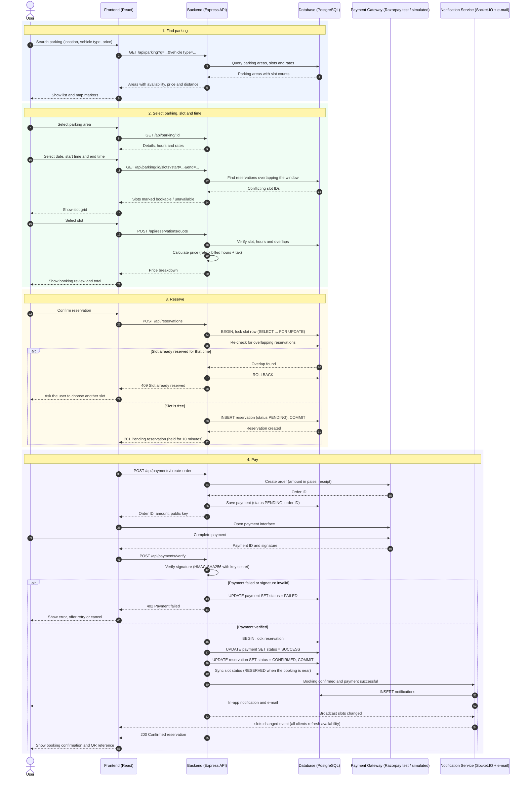

# Sequence Diagram: Find, Reserve and Pay for a Parking Slot

This is the required sequence diagram for the case study. It follows the code path exactly
(`frontend → REST API → service layer → PostgreSQL`), including the two alternative outcomes
(slot already taken, payment failed).

> Rendered image for submission: [`diagrams/sequence-diagram.png`](diagrams/sequence-diagram.png) (also available as `.svg`).

## Where each step is implemented

| Step in the case study | Realised by |
|---|---|
| User searches; frontend requests parking; backend queries database; database returns areas | `GET /api/parking` → `parking.service.listAreas` |
| User selects parking; backend returns available slots; user selects slot/time | `GET /api/parking/:id`, `GET /api/parking/:id/slots` → `slot.service.listSlots` |
| Backend verifies availability and calculates price | `POST /api/reservations/quote` → `reservation.service.quote`, `utils/pricing.calculatePrice` |
| User confirms; backend creates pending reservation | `POST /api/reservations` → `reservation.service.createReservation` |
| Payment gateway processes payment | `POST /api/payments/create-order` → `payment.service.createOrder` |
| Backend verifies payment | `POST /api/payments/verify` → `payment.service.verifyPayment`, `payment.gateway.isValidSignature` |
| Database updates reservation | transaction inside `verifyPayment` |
| Notification service sends confirmation | `notification.service.notify`, `sockets.emitToUser` |
| Frontend displays success | `frontend/src/pages/Booking.tsx` (`SuccessStep`) |
