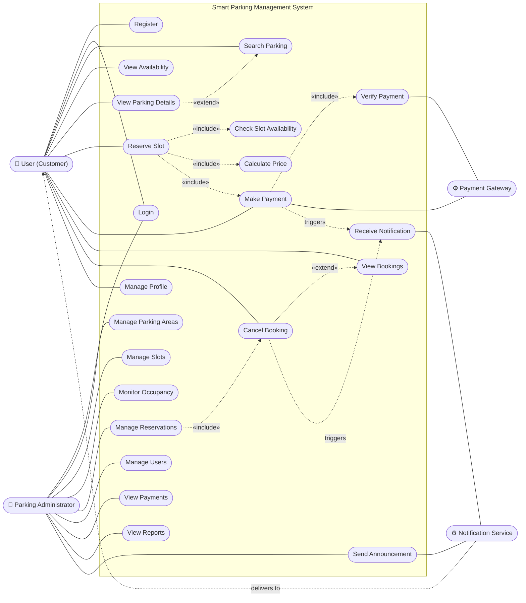

# Use Case Diagram

Mermaid has no native use-case notation, so the diagram below uses a flowchart: stick-figure
actors are drawn as rounded nodes outside the system boundary, use cases as ovals inside it.

> Rendered image for submission: [`diagrams/use-case-diagram.png`](diagrams/use-case-diagram.png) (also available as `.svg`).

## Actors

| Actor | Type | Description |
|---|---|---|
| User (Customer) | Primary, human | A driver who searches for, reserves and pays for parking. |
| Parking Administrator | Primary, human | Staff who manage parking areas and slots and monitor the system. |
| Payment Gateway | Secondary, external system | Razorpay (test mode) or the built-in simulated gateway. Creates orders and reports payment results. |
| Notification Service | Secondary, system | Delivers in-app (Socket.IO) and e-mail (Nodemailer) notifications. |

## Use cases

| ID | Use case | Actor(s) | Summary |
|---|---|---|---|
| UC1 | Register | User | Create an account with name, e-mail and password. |
| UC2 | Login | User, Admin | Authenticate and receive a JWT; the role decides which interface opens. |
| UC3 | Search Parking | User | Search by name/location; filter by vehicle type, price, availability; sort by price/distance. |
| UC4 | View Availability | User | See free bays per area and the status of each slot for a chosen time. |
| UC5 | View Parking Details | User | Address, map, hours, rates and slot layout of one area. |
| UC6 | Reserve Slot | User | Choose a slot and time window; the system validates and holds it. |
| UC7 | Make Payment | User, Payment Gateway | Pay for a pending reservation. |
| UC8 | Receive Notification | Notification Service → User | Confirmation, payment, reminder, cancellation and system messages. |
| UC9 | View Bookings | User | Upcoming, active, completed and cancelled bookings; details and receipt. |
| UC10 | Cancel Booking | User, Admin | Cancel under the cancellation policy; refund calculated by the system. |
| UC11 | Manage Profile | User | Edit name/phone, change password, manage vehicles. |
| UA1 | Manage Parking Areas | Admin | Add, edit, deactivate areas; set rates and operating hours. |
| UA2 | Manage Slots | Admin | Add, edit, delete slots; mark available/occupied/maintenance. |
| UA3 | Monitor Occupancy | Admin | Live occupancy per area; simulation of sensor updates. |
| UA4 | Manage Reservations | Admin | Search, filter, view and cancel reservations. |
| UA5 | Manage Users | Admin | View users; activate/deactivate accounts. |
| UA6 | View Payments | Admin | Payment list with status, gateway IDs and refunds. |
| UA7 | View Reports | Admin | Revenue and occupancy statistics; CSV export. |
| UA8 | Send Announcement | Admin | Broadcast a system notification to users. |

## How to draw this in standard UML

1. Draw a rectangle labelled **Smart Parking Management System**: this is the system boundary.
2. Place the two human actors (stick figures) on the **left** of the boundary: *User* and *Parking Administrator*.
3. Place the two external systems on the **right**, either as stick figures or as rectangles with the `«actor»` stereotype: *Payment Gateway* and *Notification Service*.
4. Draw each use case as an **ellipse** inside the boundary, user use cases at the top and admin use cases at the bottom.
5. Connect actors to their use cases with **solid lines** (associations, no arrowheads).
6. Draw **dashed arrows** for relationships between use cases:
   - `«include»` from *Reserve Slot* to *Check Slot Availability*, *Calculate Price* and *Make Payment* (arrow points to the included use case);
   - `«include»` from *Make Payment* to *Verify Payment*;
   - `«extend»` from *Cancel Booking* to *View Bookings* (arrow points to the base use case).
7. Optionally draw a generalisation (hollow triangle) from *User* and *Parking Administrator* to an abstract actor *Authenticated User* that owns *Login*.
